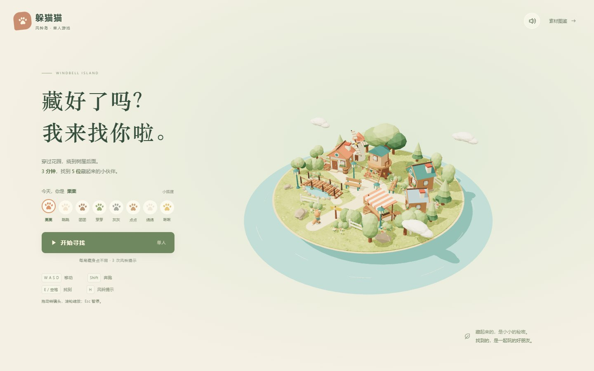
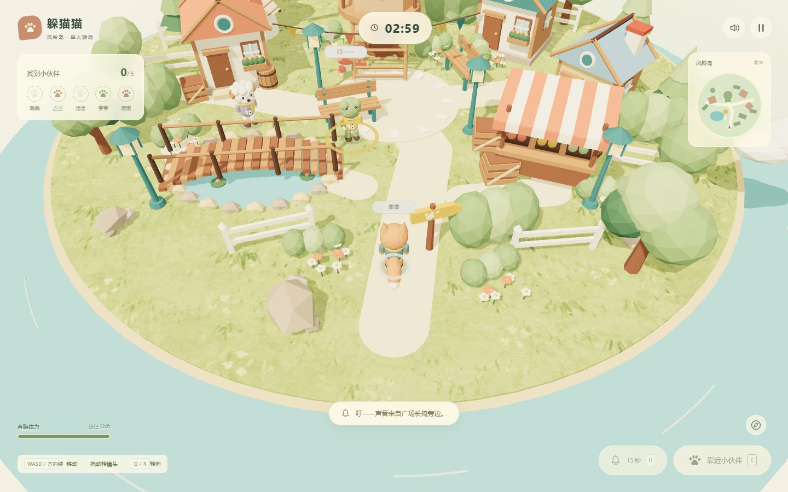

# 躲猫猫 · 风铃岛

在温暖的小岛上选择一位动物，3 分钟内找到随机藏起来的 5 位伙伴。当前默认分支已实现原创风铃岛素材的单人寻找模式。

项目基于 [arafays/messenger-copy](https://github.com/arafays/messenger-copy) 的 MIT 代码继续开发。本仓库是风铃岛的干净公开版本，不包含原 Messenger 参考素材及私库历史。

## 游戏画面

本地桌面浏览器实机截图，拍摄于 2026-10-12。





## 已实现玩法

- 8 个可选动物，随机藏身点、3 秒出发倒计时与 3 分钟回合。
- 移动、奔跑体力、场景碰撞、寻找判定和 3 次风铃提示。
- 暂停、重开、返回小镇与胜负结算；切出窗口自动暂停，本机保存最快纪录。
- `/gallery` 素材图鉴，可查看场景、角色、道具和动画。

| 操作 | 电脑 | 触屏 |
| --- | --- | --- |
| 移动 / 奔跑 | WASD、方向键 / Shift | 左摇杆 / 推到外圈 |
| 找到伙伴 | 靠近后 E 或空格 | 「找到」按钮 |
| 风铃提示 | H | 风铃按钮 |
| 镜头 | 拖动或 Q、R；滚轮缩放；C 重置 | 拖动、罗盘重置 |
| 暂停 / 声音 | Esc / M | 对应按钮 |

## 本地运行

需要 Node.js 24、pnpm 11，以及支持 WebGL 的浏览器。

```sh
pnpm install --frozen-lockfile --ignore-scripts
pnpm dev --host 127.0.0.1
```

打开 <http://127.0.0.1:5173/>。已有模型、纹理和声音均在 `public/` 内；启动会校验资产，不需要重新生成图片、调用模型或下载 Messenger 原作素材。

```sh
pnpm assets:check
pnpm build
pnpm preview --host 127.0.0.1
```

2026-10-12 已在 Windows / Node.js 24.15.0 / pnpm 11.7.0 的隔离副本完成安装、资产校验、单人启动、移动、风铃提示及构建。`adapter-auto` 未选择部署平台，因此本次构建通过不等于已完成生产部署。

其他现有检查：`pnpm check`、`pnpm test`、`pnpm assets:validate`、`pnpm test:play`。浏览器测试另需 Playwright 浏览器；这些命令不属于本次全部重跑的验证范围。

## 技术栈与目录

Svelte / SvelteKit、TypeScript、Three.js、Vite、Tailwind CSS、Vitest。以 `pnpm-lock.yaml` 锁定版本为准。

- `src/lib/duomaomao/game/`：回合、碰撞、输入、镜头和渲染。
- `src/lib/duomaomao/assets/`：场景、角色、布局与动画生成源码。
- `public/assets/models/`：33 个 GLB；`world.json` 保存出生点、障碍、水域和桥面。
- [单人玩法](docs/SINGLE-PLAYER.md)、[资产验证](docs/ASSET-VALIDATION.md)、[改造说明](docs/DUOMAOMAO.md)。

## 当前限制

这是户外单人寻找游戏。默认分支尚未实现多人房间、玩家躲藏、电脑寻找者、跳跃或建筑内部。动物使用刚性层级部件动画，不是蒙皮变形骨架。其他开发分支的存在不代表多人功能已经交付。

## 来源、归属与许可证

- 上游代码保留 [MIT 许可证](LICENSE) 和 `Copyright (c) 2026 arafays`，不替换原始署名。
- 本项目新的风铃岛资源受 [ASSET-LICENSE.txt](public/assets/ASSET-LICENSE.txt) 的原有许可约束。模型由项目代码生成，草地贴图为独立 imagegen 生成，5 段 WAV 为程序合成；详细来源见 [PROVENANCE.md](public/assets/PROVENANCE.md)。
- **MIT 不覆盖 Messenger 的原作素材。** 原作 [Messenger](https://messenger.abeto.co/) 由 [abeto](https://abeto.co/) 创作。模型、纹理、录音、字体、品牌和提取着色器的归属按 [ATTRIBUTION.md](ATTRIBUTION.md) 保留。
- 公开目录及可达 Git 历史均不包含 `reference/`、`static/`、旧 `src/lib/messenger/` 或对应参考下载脚本。原私库保留，未强推改写或删除。新增自有代码见 [LICENSE-project.txt](LICENSE-project.txt)。

本项目不隶属原作团队，也不代表原作团队。

2026-10-13 清理公开版验证：资产及压缩包校验、pnpm build、pnpm check 通过；真实浏览器开局和风铃提示通过，没有请求 Messenger/Draco 原作资源或出现页面异常。本文截图仍对应当前使用的原创素材与界面。
